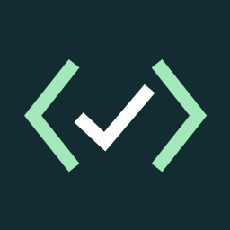

# BR Dev Compliance — Codex 1.0.0

**Versão 1.0.0 em testes em projetos de produção. A revisão jurídica independente por profissional habilitado está pendente.** As avaliações documentadas usam casos sintéticos. O plugin oferece triagem técnica de LGPD e licenças. A decisão sobre cada achado cabe ao usuário.

Para participar como revisor jurídico, abra uma issue **Revisão jurídica independente** no repositório do projeto.

Skills de auditoria de planos/entregas e consulta de cobertura para LGPD e
licenças. Instale pelo gerenciador nativo de plugins, usando o marketplace deste
pacote. No terminal, adicione a raiz do marketplace com
`codex plugin marketplace add <pasta>` e instale com
`codex plugin add br-dev-compliance@br-dev-compliance-local`.

Abra uma nova sessão e selecione **auditar** ou **cobertura** do plugin.
Informe o plano, objetivo, raiz e arquivos autorizados. Para histórico e hooks
no Windows, tenha PowerShell 7 e Git disponíveis. Revise a confiança dos hooks
no próprio cliente. A decisão de continuar, corrigir ou parar pertence ao usuário.

A avaliação técnica das alphas não aprova automaticamente a candidata 1.0.0.
Revisão jurídica independente pendente. O plugin identifica indícios no recorte
autorizado e não certifica conformidade. O auditor especializado é definido pela
skill; a delegação nativa opcional depende do pedido e do suporte do cliente.

Licença [Apache-2.0](LICENSE), [avisos](NOTICE) e
[política de identidade](TRADEMARKS.md). Permite uso em projetos pessoais,
comerciais e privados, modificação e redistribuição mediante suas condições.

**Codex no Windows.** Ao confiar nos hooks, você ativa os checkpoints automáticos. O hook Stop pode adiar o encerramento do turno para solicitar revisão ou justificativa. Para operar manualmente, mantenha os dois hooks sem confiança e invoque a skill quando desejar. Isso depende de PowerShell 7 e Git para os checkpoints.
